# The Living Sphere

### One sphere. A million pins. A machine you can watch think, and a place to think with it.

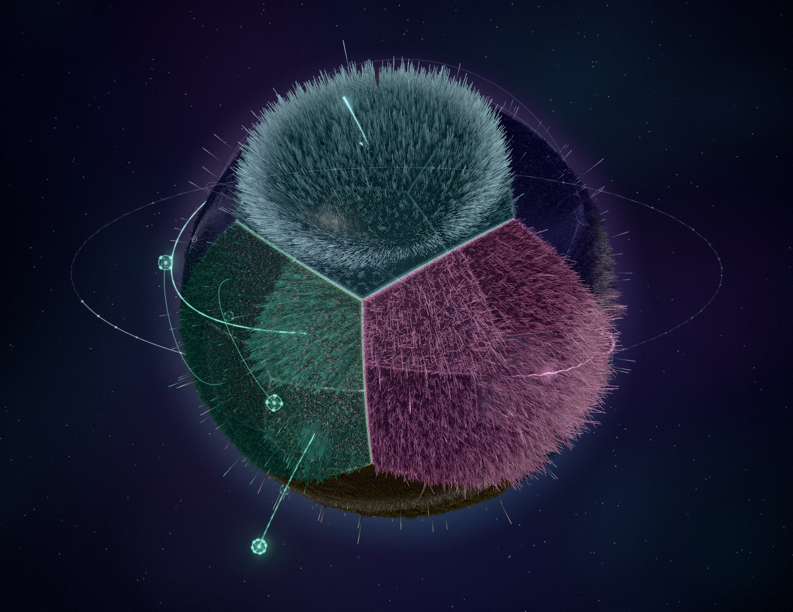

The Living Sphere shows an AI system at work as a living three-dimensional sculpture. A dark sphere carries up to 1,048,576 fine metal pins. When a question arrives they rise in ripples that travel all the way round the sphere; memories light up, ideas find each other along threads of light, predictions branch out into space and collapse when the answer comes, and tools are reached on tethers to satellites outside the sphere.

It is also an assistant you can talk to. Ask out loud or type, and you watch it listen, look things up, use its tools and reply.

## An assistant you can watch

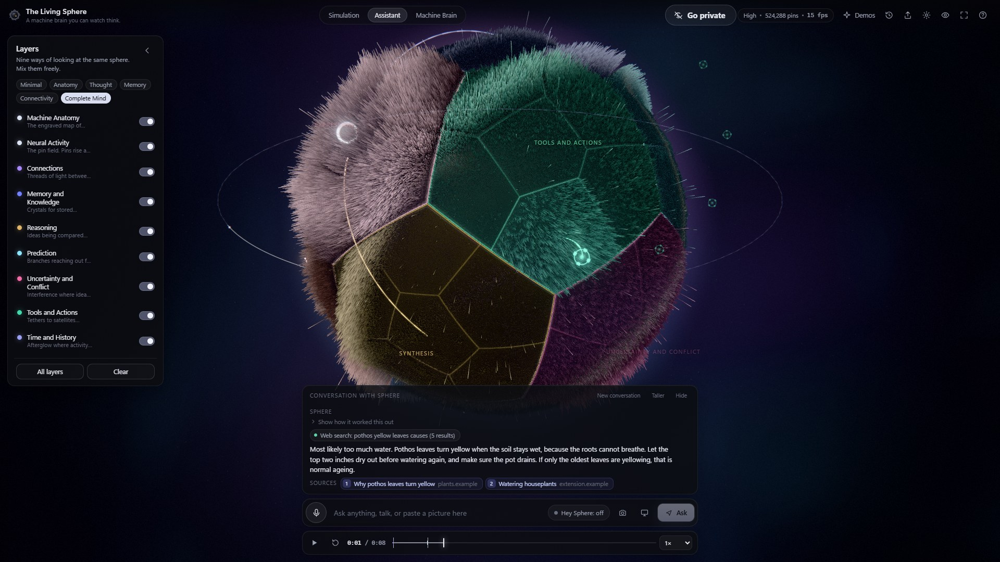

The answers come from Claude. Each step it takes shows twice: on the sphere as it happens, and in the conversation as a small line you can read afterwards.

- **Looks things up.** It searches the web and reads pages when a question needs it, then lists its sources under the answer. Every page and file it mentions has an Open button: pages open in your usual browser, documents and folders in Windows, and anything that could run as a program is only shown in its folder.
- **Hands off long jobs, and never forgets one.** Long work goes to a background helper while the conversation carries on; every job waits its turn in a queue and starts by itself. A second helper, used only when it matters, argues the other side and tries to break finished work, without changing anything. It says out loud when each job is done, and anything that needs your yes waits for you.
- **A chat that keeps everything.** Type or talk while it is busy and what you said shows straight away, waits its turn, and is answered next. The message box grows as you type, so all of it can be read before you send it.
- **Sees what you show it.** Attach a photo from the camera or a screenshot to a question, or paste any picture straight in.
- **Shows how it worked something out.** Claude's own short summary of its thinking sits folded under each answer.
- **Keeps track for you.** Timers, reminders at a clock time, and notes it remembers between conversations.
- **Drives the sphere.** "Show me memory", "play the signature demo", "zoom in", by voice or by typing.
- **Hands-free if you want it.** Give it a name and leave it running: say the name once, and while the camera sees you, you just keep talking, with no name needed. Say "that's all" and it goes back to waiting, with a soft tone; walk away and it goes quiet by itself. Or leave it open whenever you're at your desk: no name at all, and one soft ding when you sit down, never while you stay.
- **Talk over it and it stops.** It listens while it speaks, tells your voice from its own coming back through the speakers, and stops the moment you start talking. "Wait" quiets it, "stop" stops what it is doing.
- **Sees you while you talk, if you allow it.** It can use two cameras, one straight on and one from the side; a small preview shows each one whenever it is on, and each thing you say goes with fresh pictures from both.
- **Headphones or speakers, by a look.** Before it speaks it checks whether you have headphones on and switches the sound to match. It moves the sound only when two looks in a row agree, a few seconds apart, so one wrong look (a hand at your face, a bright light behind you) never sends the voice somewhere you cannot hear it.
- **A big Private button.** One press stops all listening and looking until you switch it back, even after a restart.
- **Voices to pick from,** each with a button to hear it first.
- **Can run on Claude Code.** Choose Claude Code as its brain and the assistant works the way a coding agent does, in one folder you allow: it reads, changes and creates files and runs commands, and asks first, on screen and out loud, before anything hard to undo. Every step lights the sphere where it happens.
- **Knows who is there.** Teach it your face once and it answers only you, and when someone else sits down while you are away, it asks them what they are doing and tells you what they said when you are back. Once it knows it is you, it stays sure: a change of light, a second camera or a glance at another screen does not turn you into a stranger. Faces are recognised on your own computer and kept only as numbers, never as pictures.

The camera, reading a folder of files, the face check and the headphones check are all off until you allow them, and the folder access is read-only unless Claude Code is the brain. A daily spending limit stops it asking Claude for the rest of the day.

## A figure that faces you

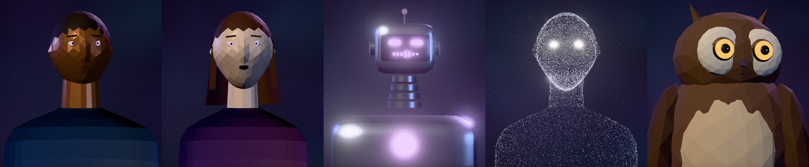

The sphere can step aside for a figure: a man, a woman, a robot, a figure made of points of light, or an owl. They are stylized sculptures on purpose, not lifelike people, and everything they do follows something real. Their eyes are open only while the cameras are on, half-closed while it just listens, and shut in Private. The mouth moves with the voice. They lean in to listen, look away while thinking, and turn toward where the camera sees you.

The voice can be the computer's own, or a natural voice from an ElevenLabs account. That one stays inside a monthly limit you set, and always leaves a reserve in the plan for other work.

## A thinking partner, not only an assistant

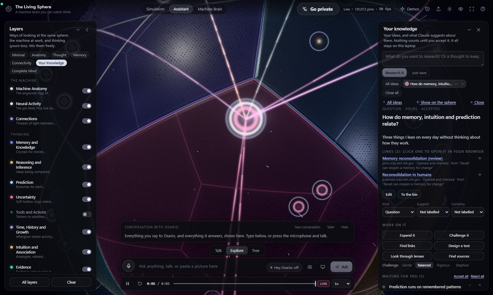

The assistant has three views over one conversation: **Talk**, **Explore** and **Tree**.

- **Explore.** Put a thought in and work it through: **expand** it into questions, assumptions and what follows; **challenge** it (gently, fairly, rigorously, or as a skeptic arguing the other side); **find links** to what you have saved, each named for what kind of link it is (a cause, an analogy, a contradiction, a guess); **design a test** you could actually run for a week; look at it through **lenses** like physics, psychology, history or spirituality, or one of your own; or **find sources**, and the sources come back with the evidence labelled (established, preliminary, an expert's reading, a guess). Every source is opened and checked before it is called checked.
- **Suggestions stay suggestions.** Nothing Claude offers counts until you accept it, and what you wrote is always marked as yours. Every idea keeps its full history, so changing your mind never erases what you thought before.
- **It still works with no AI at all.** Saving, searching, linking, history and a set of honest questions of the app's own all work offline, and say so.
- **It runs on a Claude subscription first.** A pay-per-use backup is optional, has a monthly ceiling, and says so every time it is used.

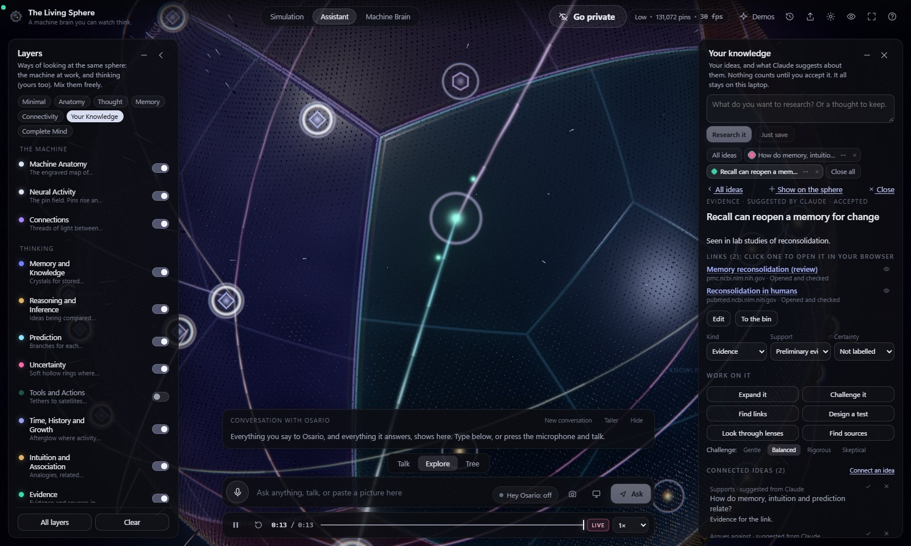

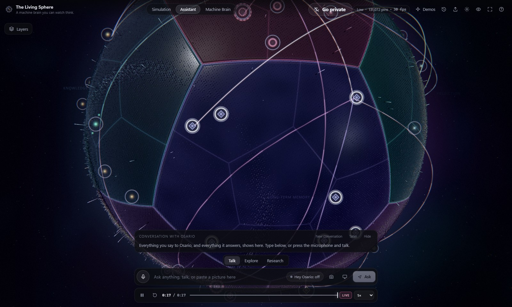

Everything you save becomes part of the sphere: each idea has a fixed home in the territory that fits its kind (open questions where the open questions are, hypotheses in Prediction, evidence in Knowledge), and links become threads. Fly to any idea, see only the one you are working on, and save a view by name to come back to.

## A map of what you know

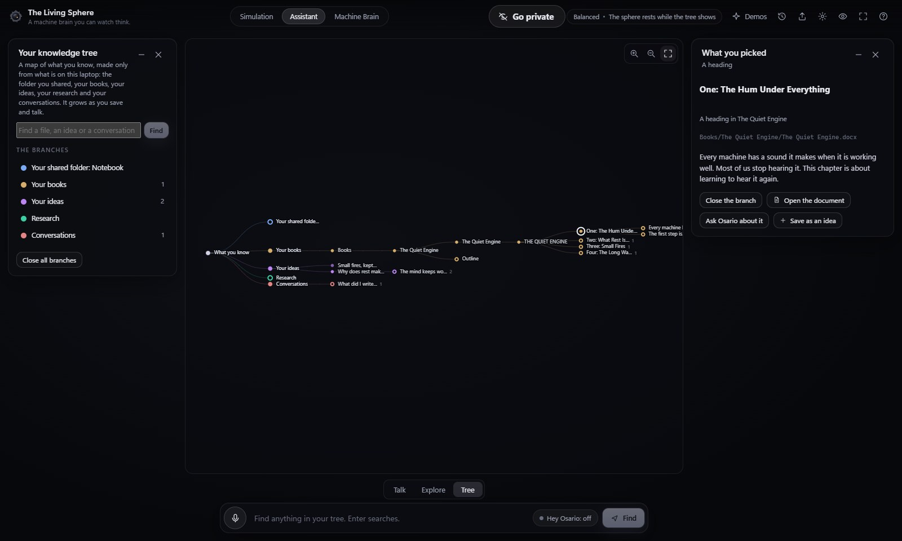

The **Tree** view lays everything out as one map: the folder you share with the assistant, the books in it, your ideas and what grew from them, your research with its checked sources, and your conversations.

- **It goes as deep as the material.** A book opens into its files, a file into its chapters, a chapter into its paragraphs, and a paragraph into its sentences. Zooming into a closed branch opens it.
- **It finds things.** Search the folder, your ideas and your conversations at once, and each result opens its way down to the match.
- **Anything you pick is useful.** Open it in its own program, ask the assistant about it, or keep a chapter or a paragraph as one of your ideas.
- **It is yours alone.** It is made only from what is on your own computer, with no AI. While it shows, the sphere rests.

Every panel has the same two buttons, fold it down to its title or close it, and the screen keeps panels side by side, so none ever lies on top of another however many are open. Ideas you open stay as tabs until you close them, each with a menu of what to do next.

## Thirteen layers, one machine

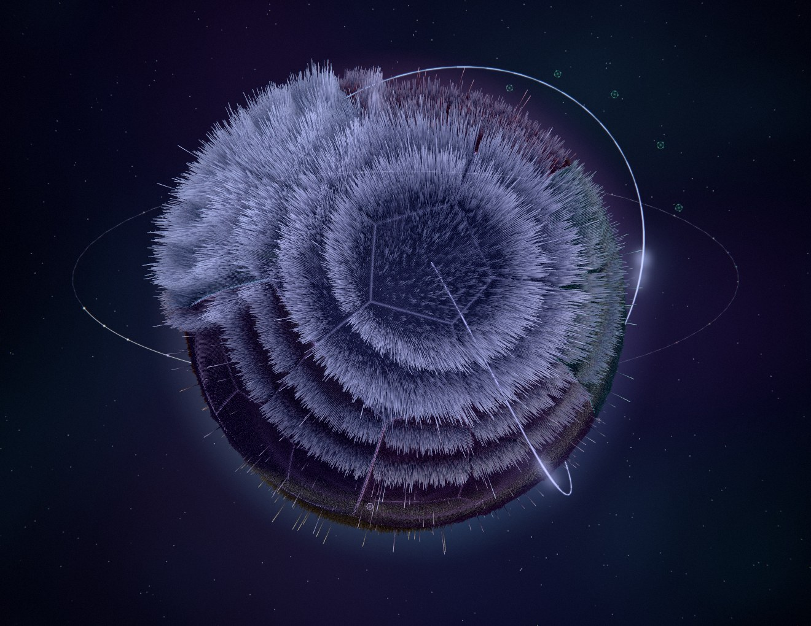

Each layer is a different way of looking at the same activity, and each draws something different, so turning them all on adds detail instead of repeating itself:

**Machine Anatomy** (the engraved map of twelve territories, 3,108 cells in all) · **Neural Activity** (the pin field) · **Connections** · **Memory and Knowledge** (crystals that grow brighter with each recall) · **Reasoning and Inference** (spokes that meet where ideas are joined) · **Prediction** (branches for each possible outcome) · **Uncertainty** (hollow rings for what is unknown, interference where information clashes) · **Tools and Actions** · **Time, History and Growth** (afterglow, and a ring that marks when everything happened) · and four for your own thinking: **Intuition and Association** · **Evidence** · **Contradiction** · **Your Contribution** (a pearl ring around everything you wrote yourself).

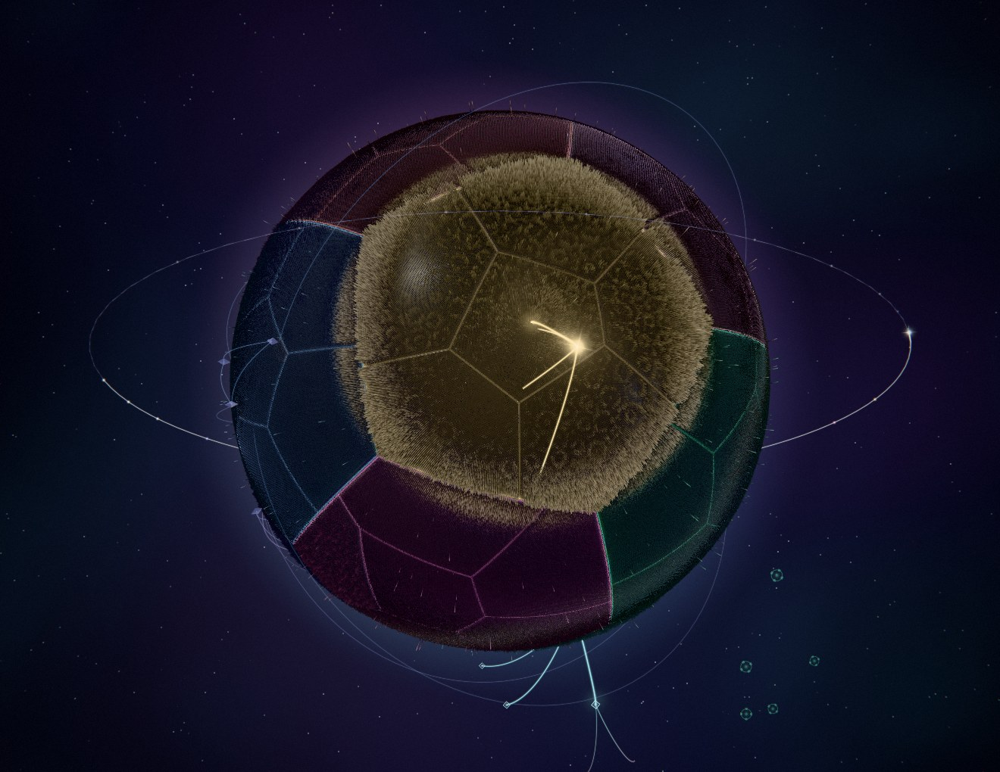

## Every territory its own colour

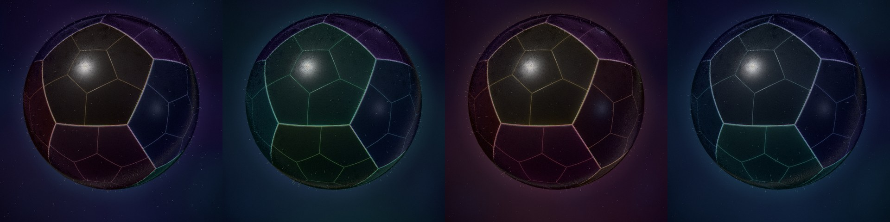

Each of the twelve territories has its own hue, carried by glowing inlays in the plates, coloured reflections in the metal, the tips of the pins, and threads that blend from one territory's colour to the next. Four palettes, from left: Spectrum, Aurora, Ember and Ocean, and a slider for how much colour you want.

## Down to a single pin

Every pin has an address: territory, region, module, microregion and site, one of 1,048,576. Click anywhere to see what it is, what activated it and when, read live from the graphics card.

## Honest about what it shows

Every event and every number is marked observed, derived or simulated. The demonstrations are simulated and say so. In assistant mode the sphere draws what the app actually records around the AI (the question, the request, the words as they arrive, every search and tool call, the thinking summary Claude provides), never claiming to see the model's hidden thoughts. A third mode runs a small learning model inside the sphere itself, whose whole state is visible: it links ideas, predicts what comes next, measures its own uncertainty and learns from its mistakes.

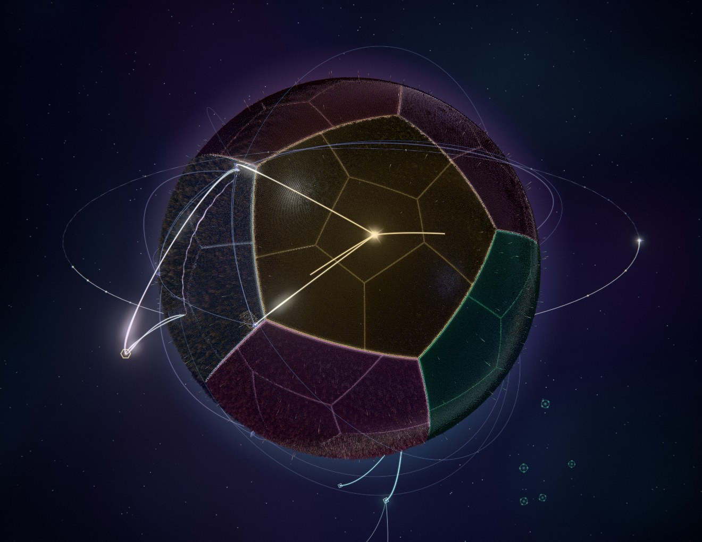

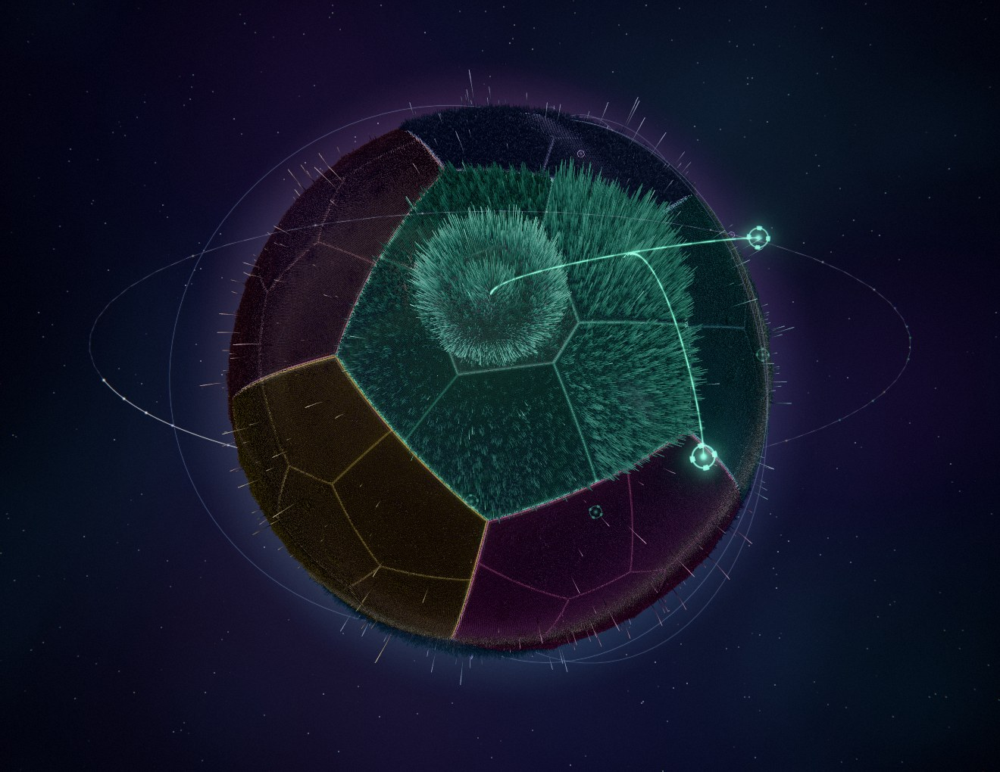

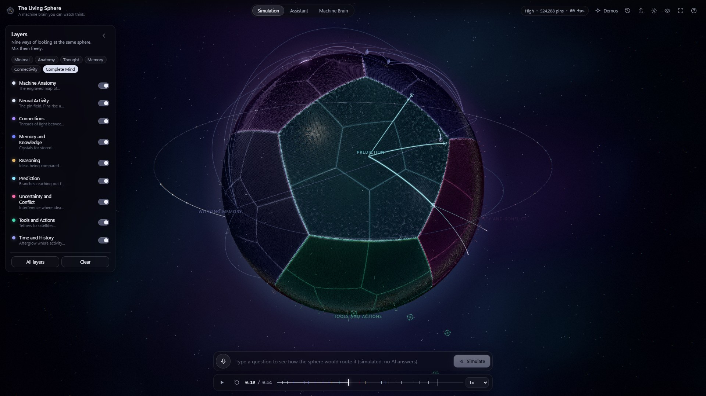

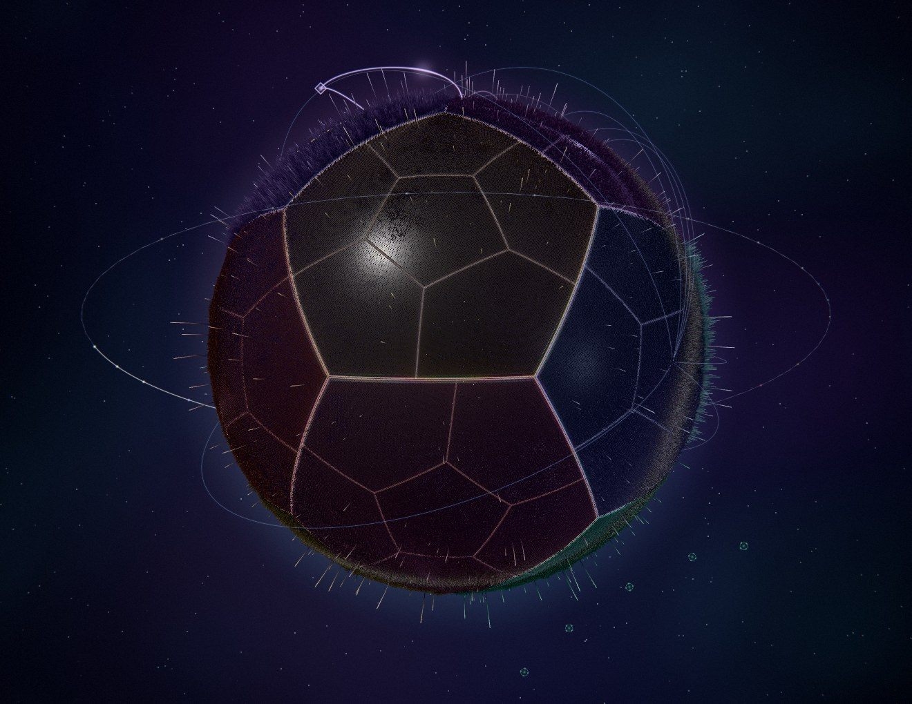

## Built with

TypeScript, three.js on WebGL 2 (a per-pin GPU pass computes every pin's motion each frame), React for the panels, the official Anthropic SDK for Claude, and the browser's own speech recognition and voices. Runs locally on Windows.

Measured on a laptop with Intel integrated graphics while a demo plays: about 55 frames a second with 131,072 pins, and 20 to 25 with all 1,048,576 (at 1440 x 900). The frame rates in the pictures were read while paused.

Created by Greygray, directing the work with Claude.
